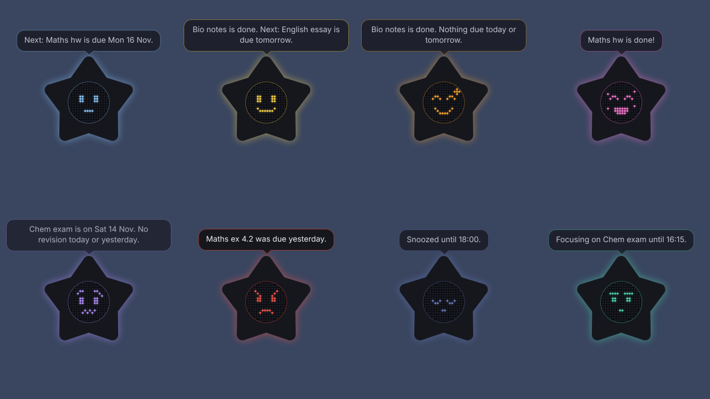

# Star Companion

A study buddy shown as a star with a pixel face. Its mood follows whether you
are keeping up with homework, exams and goals.

## What is here so far

Phases 1 and 2 of 5.

- **Core** (`packages/core`): the data model, the quick add parser ("maths hw
  fri" becomes homework due Friday), the mood engine, and the faces as 16 by
  16 pixel frames in `faces.json`.
- **Desktop app** (`apps/desktop`): the floating star for Windows. See
  [apps/desktop/README.md](apps/desktop/README.md) for how to install and
  use it.

Still to come: sync and login, the phone app, and the robot endpoint.

## Run the tests on your PC (optional)

1. Install Node.js: go to https://nodejs.org, download the LTS version, and
   click through the installer with the default options.
2. Download this project (green Code button on GitHub, then Download ZIP) and
   unzip it.
3. Open the unzipped folder, click the address bar, type `cmd` and press
   Enter. A black window opens in that folder.
4. Type `npm install` and press Enter. Wait for it to finish.
5. Type `npm test` and press Enter. You should see every test pass.

To look at the faces, run `npm run faces:preview` and open
`docs/moods/index.html` in your browser. You can edit `faces.json` and run it
again to see your changes.

## How the mood is picked

The first rule that matches wins.

1. **Focus**: a focus session is running. It never nags.
2. **Celebrate**: you finished something in the last 8 seconds.
3. **Sleepy**: snoozed, quiet hours, or a day off.
4. **Happy or proud**: for 30 minutes after you finish anything.
5. **Grumpy**: homework is overdue. Or it is after your evening time, nothing
   is done today, and homework is due tomorrow or an exam is within 3 days.
6. **Worried**: homework is due today and it is after 15:00. Or an exam is
   within 3 days and you have not revised today or yesterday.
7. **Happy**: you did something today. **Proud** if nothing is due today or
   tomorrow as well.
8. **Neutral**: everything else. It says what is next, or mentions a goal you
   have not touched in 7 days.

All the times and day counts are settings.
